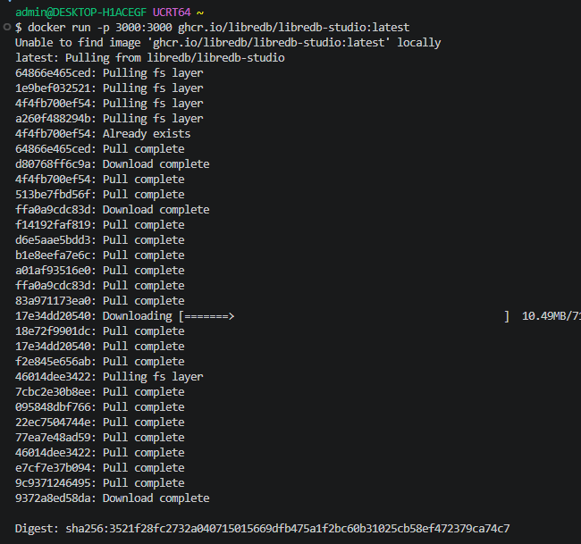
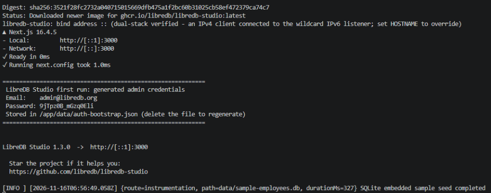
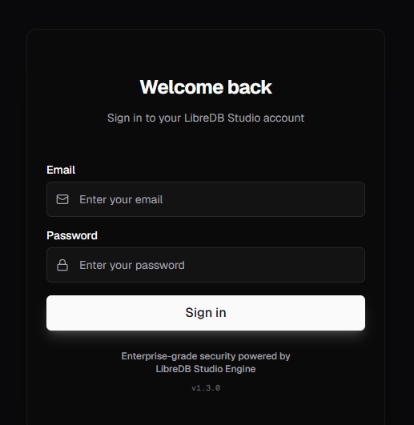
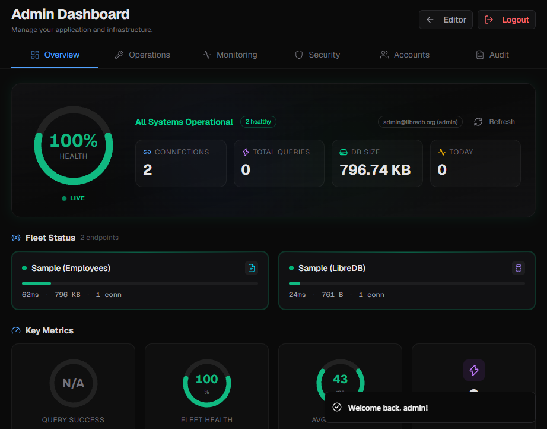
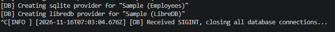
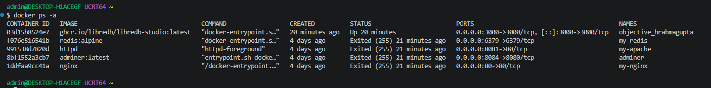
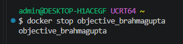
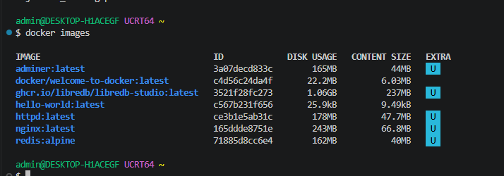

# LibreDB Studio

**LibreDB Studio** — открытая веб-IDE для работы с базами данных с лицензией MIT.

По сути, это браузерная альтернатива DataGrip и DBeaver, позволяющая выполнять SQL-запросы, визуализировать данные и администрировать базы данных через веб-интерфейс.

Вместо установки отдельного приложения на каждый компьютер LibreDB Studio разворачивается в Docker-контейнере. Пользователи получают доступ к нему через браузер.

## Содержание

1. [Создание и запуск LibreDB Studio](#1-создание-и-запуск-libredb-studio)
2. [Запуск с автоматически созданными данными](#2-запуск-с-автоматически-созданными-данными)
3. [Запуск с собственными данными](#3-запуск-с-собственными-данными)
4. [Выход из проекта](#4-выход-из-проекта)
5. [Удаление проекта](#5-удаление-проекта)
6. [Полезные ссылки](#полезные-ссылки)

---

## 1. Создание и запуск LibreDB Studio

Перед началом работы убедитесь, что порт **3000** не занят другим приложением.

Для запуска LibreDB Studio используется следующий Docker-образ:

`ghcr.io/libredb/libredb-studio:latest`

## 2. Запуск с автоматически созданными данными

Откройте терминал WSL (Ubuntu) и выполните команду:

```bash
docker run -p 3000:3000 ghcr.io/libredb/libredb-studio:latest
```

**Скриншот 1 — запуск LibreDB Studio**



После запуска в консоли автоматически появятся сгенерированные **e-mail и пароль**.

Сохраните их — они понадобятся для входа в приложение.

**Скриншот 2 — автоматически созданные данные для входа**



Откройте браузер и перейдите по адресу:

**http://localhost:3000**

Введите полученные e-mail и пароль в интерфейсе **Sign In**.

**Скриншот 3 — окно авторизации LibreDB Studio**



## 3. Запуск с собственными данными

Также можно заранее указать собственные e-mail и пароль.

В терминале WSL выполните:

```bash
docker run -d \
  --name libredb-studio \
  -p 3000:3000 \
  -e ADMIN_EMAIL=admin@example.com \
  -e ADMIN_PASSWORD=YourStrongPassword \
  -e JWT_SECRET=your-random-32-char-secret-string \
  ghcr.io/libredb/libredb-studio:latest
```

**Скриншот 4 — запуск LibreDB Studio с собственными данными**



Где:

- `admin@example.com` — ваш e-mail.
- `YourStrongPassword` — ваш пароль.
- `your-random-32-char-secret-string` — секретная строка для JWT.

Замените примеры на собственные значения.

После запуска откройте:

**http://localhost:3000**

Для входа используйте указанные вами e-mail и пароль.

**Скриншот 5 — вход с собственными данными**


## 4. Выход из проекта

Если вы запустили контейнер командой без параметра `-d`, для выхода из проекта выполните:

```text
Ctrl + C
```

**Скриншот 6 — завершение работы**



## 5. Удаление проекта

### Шаг 1. Получение списка контейнеров

Выполните:

```bash
docker ps -a
```

Найдите контейнер LibreDB Studio и запомните его имя.

**Скриншот 7 — список контейнеров**



### Шаг 2. Остановка контейнера

Если контейнер запущен, остановите его:

```bash
docker stop competent_sinoussi
```

Вместо `competent_sinoussi` укажите имя своего контейнера.

### Шаг 3. Удаление контейнера

Выполните:

```bash
docker rm competent_sinoussi
```

**Скриншот 9 — удаление контейнера**



### Шаг 4. Получение списка образов

Чтобы найти Docker-образ LibreDB Studio, выполните:

```bash
docker images
```

**Скриншот 10 — список Docker-образов**



### Шаг 5. Удаление Docker-образа

Выполните:

```bash
docker image rm ghcr.io/libredb/libredb-studio:latest
```

---

## Полезные ссылки

- [LibreDB Studio — анонс новой версии](https://www.opennet.ru/opennews/art.shtml?num=66216)

---